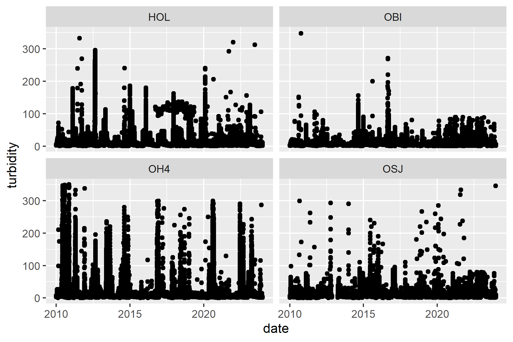
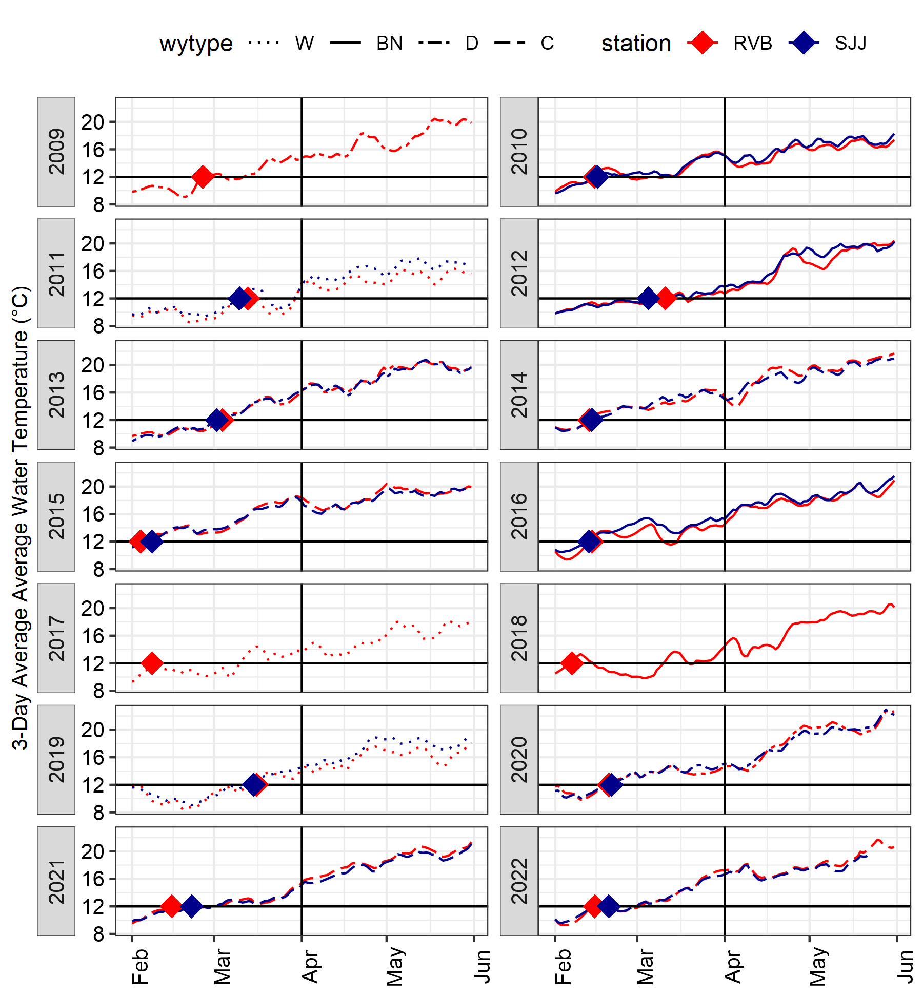

```{r global_options, include=FALSE}
knitr::opts_chunk$set(echo = TRUE, warning =FALSE, message = FALSE, fig.pos = "H")
```

```{r, echo = FALSE}
library(lubridate)
library(ggplot2)
library(dplyr)
library(tidyr)
library(CDECRetrieve)
library(here)
library(knitr)
library(kableExtra)
library(sf)
library(deltamapr)
```

# Methods

## Download Turbidity Data from CDEC (15-minute data)

```{r, echo = FALSE, eval = FALSE}
stations_turb <- c("OBI", "HOL", "OH4", "OSJ")

turb <- lapply(stations_turb,
                 function(x){
                 cdec_query(station = x, sensor_num = 221, dur_code = "E", start_date = "2010-01-01",
                              end = "2024-01-01")})

turb_df <- bind_rows(turb)%>%
    mutate(turbidity = parameter_value,
           datetime = ymd_hms(datetime),
           date = date(datetime),
           year = year(date),
           month = month(date),
           wy = if_else(month>9, year + 1, year)) %>%
  filter(turbidity>0) %>%
  select(datetime,date,month, wy, year, station = location_id, turbidity) %>%
  filter(!is.na(station),
         !is.na(date))

saveRDS(turb_df, "data_raw/turbidity_cdec_OBI_HOL_OH4_OSJ_2010-2023.rds")
```

## Clean turbidity data 

### Remove dates with less than 12 values in a day
```{r, eval = FALSE}
turb_df <- readRDS("data_raw/turbidity_cdec_OBI_HOL_OH4_OSJ_2010-2023.rds")

turb_qc <- turb_df %>%
  mutate(hour = hour(datetime)) %>%
  group_by(station, wy, month, date, hour) %>%
  slice(1) %>%
  ungroup() %>%
  select(-datetime) %>%
  group_by(station, wy, month, date) %>%
  summarise(total = n()) %>%
  mutate(Flag_QC = ifelse(total < 13, "Y", "N"))  %>%
  select(-total)

turb_q1 <- turb_df %>% left_join(turb_qc) %>%
  filter(Flag_QC == "N") %>%
  select(datetime,date,wy, month, station , turbidity)
```

### Remove periods where values are repetitive (likely sensor issue) 
```{r, eval = FALSE}
repeating_vals = function(df, x){
  df$same = ifelse(df$turbidity == lag(df$turbidity, 1, default = 0), 1L, 0L)
  df = df %>%
    mutate(issame = cumsum(df$same == 0L)) %>%
    group_by(station, issame) %>%
    mutate(flag = sum(same)+1 ) %>%
    ungroup() %>%
    mutate(Flag_repeats = ifelse(flag > x, "Y", "N"))
  return(df)
}
```

threshold = 6 hours in a row (24 points)
```{r, eval = FALSE}
# Run function repeating values and get rid of the columns we don't need
turb_q2 <- repeating_vals(df = turb_q1, x = 24) %>%
  select(-flag, -issame, -same) %>%
  rename(Flag_QC2 = Flag_repeats) 

turb_q2_clean <- turb_q2 %>%
  filter(Flag_QC2 == "N")

# Flagged values
turb_flagged <- turb_q2_clean %>%
  filter(Flag_QC2 == "Y")
```

```{r, include = FALSE, eval = FALSE}
library(anomalize)
turb_q3 <- turb_q2_clean %>%
    group_by(station) %>%
    time_decompose(turbidity, method = "stl", trend = "3 months") %>%
    anomalize(remainder, method = "iqr", alpha = 0.025) %>%
    time_recompose() %>% 
    select(c(datetime, anomaly)) %>%
    as_tibble() 

# Join "anomaly" with rest of the data
turb_q3_a <- inner_join(turb_q2_clean, turb_q3, by = c( "datetime", "station"))%>%
    mutate(anomaly = factor(anomaly)) %>%
    mutate(anomaly = recode(anomaly, No = "N", Yes = "Y"))  %>%
    rename(Flag_QC3 = anomaly)

# Remove 
turb_q3_clean <- turb_q3_a %>% filter(Flag_QC3 == "N")

```
### Remove high values (>=350 FNU)
```{r, eval = FALSE}
turb_clean <- turb_q2_clean %>%
  filter(turbidity<350)

# saveRDS(turb_clean, "data_clean/clean_turbidity_OBI_HOL_OH4_OSJ_event.rds")
```

### Look at data 
```{r , include = FALSE, eval = FALSE}
ggplot(turb_df) + geom_point(aes(date, turbidity)) + facet_wrap(~station)
ggplot(turb_daily) + geom_point(aes(date, turbidity_daily)) + facet_wrap(~station)
```

```{r data_clean-fig, fig.cap = "Event (15-minute) data from CDEC for HOL, OBI, OH4, OSJ after cleaning (see methods for steps).", fig.width = 7, fig.height = 5}
turb_clean <- readRDS(here("data_clean/clean_turbidity_OBI_HOL_OH4_OSJ_event.rds"))

# png("figures/HOL_OBI_OH4_OSJ_lightlycleaneddata.png", res = 300, units = "in", width = 6, height = 4)
# 
# ggplot(turb_clean) + geom_point(aes(date, turbidity)) + facet_wrap(~station)
# 
# dev.off()


```


Data are still messy with light cleaning. 


## Convert to daily data

* Convert to daily
* Filter to December-March

```{r}
turb_daily <- turb_clean %>%
  group_by(date, month, wy, station) %>%
  summarize(turbidity_daily = mean(turbidity)) %>%
  ungroup() %>%
  mutate(date2 = paste0(1980, "-", month, "-", day(date)),
         date2 = lubridate::ymd(date2),
         year = year(date),
         fWY = factor(wy)) %>%
  filter(month %in% c(12, 1, 2, 3))
```

## Calculate number of days under each option where Turbidity Bridge would be triggered

```{r}
turb_wide <- turb_daily %>%
  pivot_wider(names_from = "station", 
              values_from = "turbidity_daily") %>%
  mutate(Opt1 = if_else(OBI >= 12, 1L, 0L),
         Opt2 = if_else(OBI >=12 & HOL >=12 & OH4 >=12, 1L, 0L),
         Opt3 = if_else(OBI >=12 & HOL >=12 & OSJ >=12, 1L, 0L))

turb_days <- turb_wide %>%
  select(wy, fWY, Opt1, Opt2, Opt3) %>%
  pivot_longer(cols =c(Opt1, Opt2, Opt3), names_to = "Option", values_to = "exceeding_threshold") %>%
  group_by(wy, fWY, Option) %>%
  summarize(days_exceeding = sum(exceeding_threshold,na.rm = TRUE)) %>%
  ungroup() %>%
  mutate(Option = case_when(Option == "Opt1" ~ "OBI only" ,
                   Option == "Opt2" ~ "OBI, HOL, OH4",
                   Option == "Opt3" ~ "OBI, HOL, OSJ"))
```

# Results

## Plots and Tables

```{r map_stations-fig, echo = FALSE, fig.cap = "Map of Turbidity Stations"}
latlons <- read.csv("data_raw/turbidity_station_latlons.csv")
latlon_sf <- st_as_sf(latlons, coords = c("Longitude", "Latitude"), crs = 4326, remove = FALSE)
delta_4326 <- st_transform(WW_Delta, crs = st_crs(latlon_sf))

(map <- ggplot() + 
  geom_sf(data = delta_4326, fill = "lightblue", color = "lightblue") +
  geom_sf(data = latlon_sf, 
          color = "black", size = 3.5, shape = 18, 
          inherit.aes = FALSE)+
  geom_text(data = latlon_sf, aes(x = Longitude, y = Latitude, 
                                  label = station), size = 4, 
            vjust = 1, hjust = 1.5)+
  scale_x_continuous(limits = c(-121.85, -121.25)) +
  scale_y_continuous( limits = c(37.75, 38.2)) )
```

```{r threshold-fig, echo = FALSE, fig.cap = "Days Triggering Turbidity Bridge Action for Different Turbidity Station Combinations."}

# png(filename = "figures/omr_turbidity_daysexceeding12.png", height = 5, width = 7, units = "in", res = 300)
ggplot(turb_days) +
  geom_col(aes(fWY, days_exceeding, fill = Option), position = "dodge2", color = "black") +
  geom_text(aes(fWY, days_exceeding + 2, label = days_exceeding, 
                group = Option), 
            position = position_dodge(width = 0.9), size = 2.8) + 
  viridis::scale_fill_viridis(discrete = "TRUE") +
  labs(y = "Days exceeding 12 FNU Turbidity", x= "Water Year") +
  theme_classic() +
  theme(legend.position = "top")

# dev.off()
```


```{r , include = FALSE }
turb_table <- turb_days %>%
  select(wy, Option, days_exceeding) %>%
  pivot_wider(names_from = Option, values_from = days_exceeding)
```

```{r turb-tab, echo = FALSE}
kable(turb_table, "latex", align = "c", booktabs = TRUE,
      caption = "Adult Delta Smelt Turbidity Bridge Action: 
      Days meeting trigger under various combinations of stations.") %>%
  kable_styling(latex_options = "striped", "HOLD_position", font_size = 13)
```

## Notes

* High flow offramp specifications are not considered in this analysis.
* Dates are filtered to Dec 1 - March 31 of each year to represent the season for Adult Delta Smelt. RVB and SJJ have reached 3-day average water temperatures of 12°C/53.6°F (representing a shift to larval Delta Smelt lifestage) prior to April 1 since 2009 (Figure 4). First detection of Delta Smelt larvae also generally occurs prior to April 1. 

```{r temp-fig, echo = FALSE, fig.cap = "3-day Average Water Temperatures at Rio Vista Bridge (RVB) and San Joaquin River at Jersey Point (SJJ), WY 2009-2021. Certain years are missing SJJ data (2009, 2017, 2018). Line pattern indicates water year type."}

```
